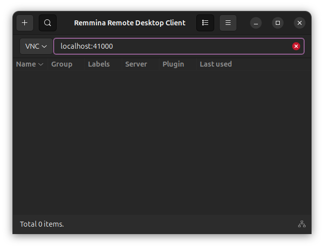
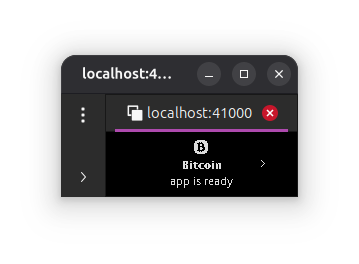

## Emulators
To test ledger devices without a physical device, ledger provides an emulator called speculos.
This packages runs docker containers for test automation.

### Run Emulators
```Bash
bitcore/packages/bitcore-hardware
$ docker compose up
```

## Interact with Emulators
The emulators can be connected over vnc.
Use a vnc client such as [Remmina](https://remmina.org/).




The speculos containers only run one app (that is one chain) at a time. Consequently, connecting to speculos container requries a different port for each chain.
| Chain | Port |
|---|---|
| Bitcoin | 41000 |
| Ethereum | 40001 |
| Solana | 40002 |
| Bitcoin Cash | 40003 |
| Dogecoin | 40004 |
| Litecoin | 40005 |

Alternatively, use the docker cli to get the vnc port:
```Bash
bitcore/packages/bitcore-hardware
$ docker port bitcore-hardware-speculos-bitcoin-1
1234/tcp -> 0.0.0.0:1234
1234/tcp -> [::]:1234
5000/tcp -> 0.0.0.0:5000
5000/tcp -> [::]:5000
40000/tcp -> 0.0.0.0:40000
40000/tcp -> [::]:40000
41000/tcp -> 0.0.0.0:41000
41000/tcp -> [::]:41000
```

### Configuration
All the speculos containers are configured in the docker-compose.yml file.
The containers need wallet apps. The compose file passes in the apps from test/ledger/apps into the speculos contianers. 

The apps are generated from the ledger source code.
| Chain | App Source Code |
|---|---|
| Bitcoin | https://github.com/LedgerHQ/app-bitcoin |
| Ethereum | https://github.com/LedgerHQ/app-ethereum |
| Solana | https://github.com/LedgerHQ/app-solana |
| Bitcoin Cash | https://github.com/LedgerHQ/app-bitcoin-legacy |
| Dogecoin | https://github.com/LedgerHQ/app-bitcoin-legacy |
| Litecoin | https://github.com/LedgerHQ/app-bitcoin-legacy |

Ledger provides a [VS Code extension](https://developers.ledger.com/docs/device-app/beginner/vscode-extension) to simplify the compilation process.
